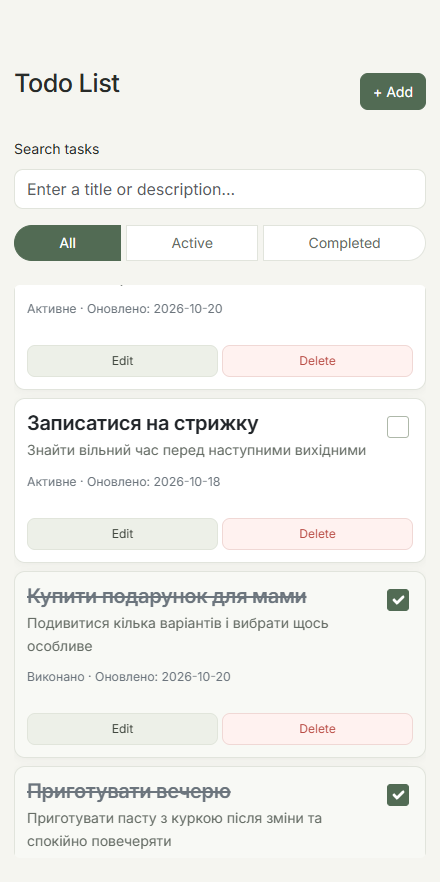

# Todo List

Простий застосунок для керування задачами, створений за допомогою HTML, CSS, JavaScript та Bootstrap 5.

## Функціонал

- Додавання, редагування та видалення задач.
- Позначення задач як виконаних.
- Збереження даних у `localStorage`.
- Пошук за назвою в реальному часі.
- Фільтрація за статусом: All, Active, Completed.
- Збереження стану фільтра та модалок в URL.
- Адаптивний інтерфейс.

## Технології

HTML · CSS · JavaScript · ES Modules · Bootstrap 5 · localStorage

## Скріншот

